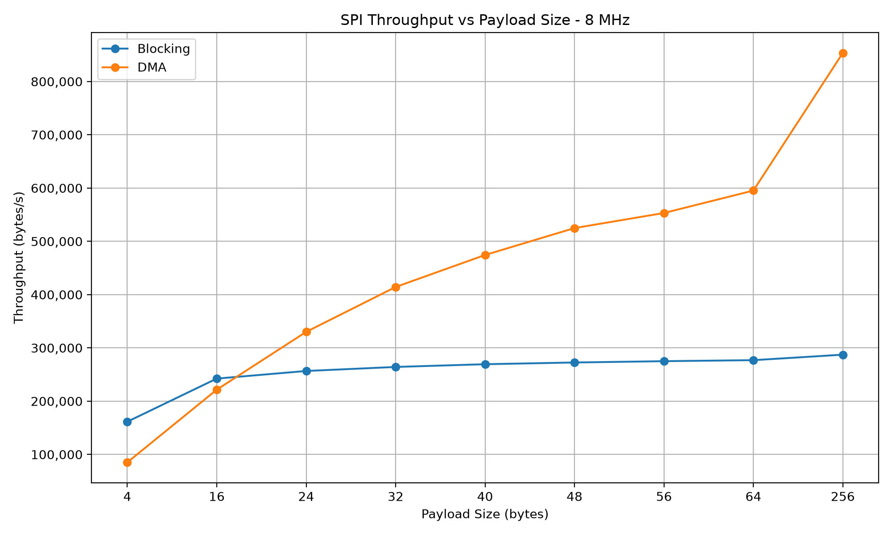
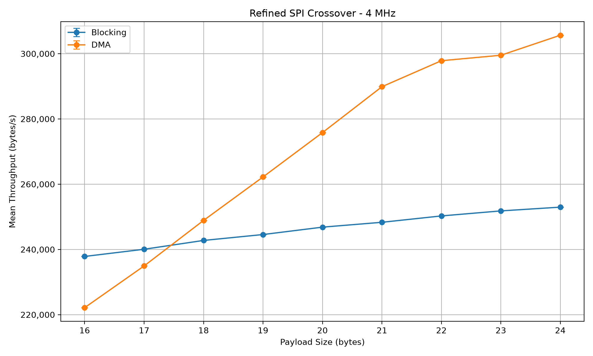
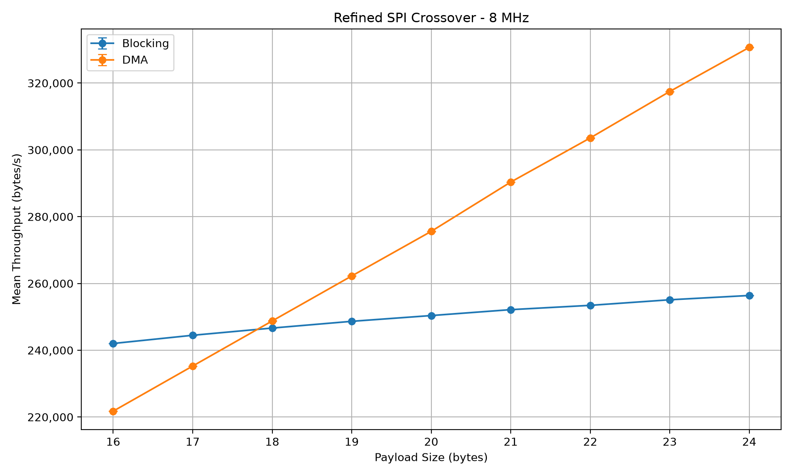

# STM32U585 SPI Performance Benchmark

Embedded Rust benchmarking framework for comparing **blocking SPI and DMA-backed SPI** on the STM32U585.

Built and tested on the **MM6108-EKH05** using **Rust, Embassy, STM32U585, DMA, Cortex-M DWT cycle counting, RTT, probe-rs, and Python-based statistical analysis**.

The project investigates an important embedded-systems performance question:

> At what payload size does DMA begin providing a measurable performance advantage over blocking SPI?

The benchmark evaluates this question across several SPI frequencies, payload
sizes, and repeated independent hardware experiments.

---

## Key Result

The refined experiment identified a highly consistent blocking-to-DMA crossover.

At both:

```text
4 MHz
8 MHz
```

blocking SPI remained faster at:

```text
17 bytes
```

while DMA became faster at:

```text
18 bytes
```

Across **30 independent refined benchmark runs**, the detected crossover was:

| SPI Frequency | Crossover Interval | Runs | Consistency |
|--------------:|:-------------------|-----:|------------:|
| 4 MHz | 17–18 bytes | 30 / 30 | **100%** |
| 8 MHz | 17–18 bytes | 30 / 30 | **100%** |

The paired statistical analysis independently supports this result.

At both frequencies:

```text
17 bytes:
95% confidence interval for DMA − Blocking < 0
→ Blocking statistically faster

18 bytes:
95% confidence interval for DMA − Blocking > 0
→ DMA statistically faster
```

Therefore:

> **18 bytes is the first tested payload size with a statistically supported DMA throughput advantage at both 4 MHz and 8 MHz.**

---

## Refined Crossover Result

### 4 MHz

At 17 bytes:

```text
Mean DMA − Blocking throughput:
-5,109.20 B/s

95% confidence interval:
[-5,113.78, -5,104.62] B/s
```

The entire confidence interval is below zero.

Therefore:

```text
Blocking faster
```

At 18 bytes:

```text
Mean DMA − Blocking throughput:
+6,142.00 B/s

95% confidence interval:
[6,142.00, 6,142.00] B/s
```

The entire confidence interval is above zero.

Therefore:

```text
DMA faster
```

Measured crossover:

```text
17–18 bytes
```

Observed in:

```text
30 / 30 runs
100%
```

---

### 8 MHz

At 17 bytes:

```text
Mean DMA − Blocking throughput:
-9,209.47 B/s

95% confidence interval:
[-9,233.75, -9,185.19] B/s
```

The entire confidence interval is below zero.

Therefore:

```text
Blocking faster
```

At 18 bytes:

```text
Mean DMA − Blocking throughput:
+2,129.53 B/s

95% confidence interval:
[2,053.46, 2,205.60] B/s
```

The entire confidence interval is above zero.

Therefore:

```text
DMA faster
```

Measured crossover:

```text
17–18 bytes
```

Observed in:

```text
30 / 30 runs
100%
```

---

## Hardware

| Component | Configuration |
|:----------|:--------------|
| Board | MM6108-EKH05 |
| MCU | STM32U585AI |
| CPU Core | ARM Cortex-M33 |
| Debug Probe | ST-LINK V3 |
| System Clock | 16 MHz HSI |
| SPI Peripheral | SPI1 |
| Maximum Tested SPI Clock | 8 MHz |

### SPI1 Pins

| Signal | Pin |
|:-------|:----|
| SCK | PE13 |
| MISO | PE14 |
| MOSI | PE15 |
| CS | PE12 |

Chip select is controlled in software through PE12.

---

# Benchmark Experiments

The project contains two related experiments.

## Standard Benchmark

The standard benchmark evaluates broad SPI scaling behavior.

SPI frequencies:

```text
1 MHz
2 MHz
4 MHz
8 MHz
```

Payload sizes:

```text
4
16
24
32
40
48
56
64
256 bytes
```

Transfer methods:

```text
Blocking
DMA
```

Iterations per benchmark configuration:

```text
100
```

One complete standard benchmark contains:

```text
4 frequencies
×
9 payload sizes
×
2 transfer methods
=
72 measurements
```

Thirty independent standard runs contain:

```text
30 × 72
=
2,160 measurements
```

---

## Refined Crossover Benchmark

The refined experiment focuses specifically on the crossover region identified
by the standard benchmark.

SPI frequencies:

```text
4 MHz
8 MHz
```

Payload sizes:

```text
16
17
18
19
20
21
22
23
24 bytes
```

Transfer methods:

```text
Blocking
DMA
```

One refined run contains:

```text
2 frequencies
×
9 payload sizes
×
2 transfer methods
=
36 measurements
```

Thirty independent refined runs contain:

```text
30 × 36
=
1,080 measurements
```

This one-byte payload resolution allows the blocking-to-DMA transition to be
localized much more precisely than the original benchmark.

---

# Representative Standard Benchmark Results

In a representative hardware run at **8 MHz with a 256-byte payload**:

| Transfer Method | Throughput | Avg. Elapsed Cycles / Transfer |
|:----------------|-----------:|-------------------------------:|
| Blocking | 287,211 B/s | 14,261 |
| DMA | **853,390 B/s** | **4,800** |

In this representative run, DMA achieved approximately:

```text
197% higher throughput
```

than blocking SPI.



These values represent a single hardware run.

Repeated-run statistical measurements are analyzed separately.

---

# Standard Benchmark Findings

The broad benchmark demonstrated that:

- Blocking SPI performs well for very small transfers.
- DMA overhead can make DMA slower than blocking for small payloads.
- DMA becomes increasingly beneficial as payload size increases.
- DMA benefits increase at higher SPI frequencies.
- Blocking throughput begins to plateau as software overhead becomes more significant.
- DMA continues scaling more strongly at higher SPI frequencies.
- At 4 MHz and 8 MHz, the original payload set placed the crossover between 16 and 24 bytes.
- Asynchronous DMA allows the Embassy executor to schedule other tasks while the transfer is waiting for completion.

---

# Representative Throughput Results

## Blocking Throughput

| SPI Clock | 4 B | 16 B | 64 B | 256 B |
|----------:|----:|-----:|-----:|------:|
| 1 MHz | 79,856 B/s | 109,656 B/s | 120,670 B/s | 123,909 B/s |
| 2 MHz | 124,649 B/s | 199,750 B/s | 235,216 B/s | 246,118 B/s |
| 4 MHz | 154,083 B/s | 237,706 B/s | 275,482 B/s | 286,828 B/s |
| 8 MHz | 161,420 B/s | 242,314 B/s | 276,912 B/s | 287,211 B/s |

## DMA Throughput

| SPI Clock | 4 B | 16 B | 64 B | 256 B |
|----------:|----:|-----:|-----:|------:|
| 1 MHz | 63,724 B/s | 100,927 B/s | 117,963 B/s | 122,150 B/s |
| 2 MHz | 85,251 B/s | 169,294 B/s | 224,490 B/s | 239,918 B/s |
| 4 MHz | 85,070 B/s | 221,514 B/s | 408,919 B/s | 472,307 B/s |
| 8 MHz | 85,269 B/s | 221,208 B/s | 595,792 B/s | **853,390 B/s** |

---

# DMA Crossover Analysis

The original benchmark payload sizes included:

```text
16 bytes
24 bytes
```

but did not include the byte values between them.

The standard experiment therefore identified the crossover only as:

```text
4 MHz:
16–24 bytes

8 MHz:
16–24 bytes
```

The refined experiment subsequently tested every byte between these values.

---

# Refined Crossover Consistency

The measured refined crossover distribution is stored in:

```text
results/refined_crossover_statistics.csv
```

The experiment produced:

```text
spi_frequency_hz,crossover_lower_bytes,crossover_upper_bytes,run_count,total_runs,percentage

4000000,17,18,30,30,100.00
8000000,17,18,30,30,100.00
```

This means the same crossover interval appeared in every independent refined
experiment:

```text
4 MHz:
17–18 bytes
30/30 runs

8 MHz:
17–18 bytes
30/30 runs
```

No alternative crossover interval was observed in the 30-run refined dataset.

---

# Paired Blocking-vs-DMA Analysis

The refined analysis compares blocking and DMA measurements from the same:

```text
run
frequency
payload
```

The analyzed quantity is:

```text
DMA throughput - Blocking throughput
```

Interpretation:

```text
Difference < 0
→ Blocking faster

Difference > 0
→ DMA faster
```

More importantly, the analysis calculates a 95% confidence interval for the
paired difference.

If the entire interval is below zero:

```text
Blocking faster
```

If the entire interval is above zero:

```text
DMA faster
```

If the interval crosses zero:

```text
Difference uncertain at the 95% confidence level
```

---

# Refined Paired Results

## 4 MHz

| Payload | Mean DMA − Blocking | 95% CI | Interpretation |
|--------:|--------------------:|:-------|:---------------|
| 16 B | -15,695.90 B/s | [-15,703.06, -15,688.74] | Blocking faster |
| 17 B | -5,109.20 B/s | [-5,113.78, -5,104.62] | Blocking faster |
| 18 B | +6,142.00 B/s | [6,142.00, 6,142.00] | DMA faster |
| 19 B | +17,657.83 B/s | [17,643.35, 17,672.32] | DMA faster |
| 20 B | +28,991.27 B/s | [28,981.62, 29,000.92] | DMA faster |
| 21 B | +41,566.67 B/s | [41,559.51, 41,573.83] | DMA faster |
| 22 B | +47,584.43 B/s | [47,483.72, 47,685.15] | DMA faster |
| 23 B | +47,715.17 B/s | [47,711.51, 47,718.83] | DMA faster |
| 24 B | +52,700.40 B/s | [52,693.49, 52,707.31] | DMA faster |

First tested payload with statistically supported DMA advantage:

```text
18 bytes
```

---

## 8 MHz

| Payload | Mean DMA − Blocking | 95% CI | Interpretation |
|--------:|--------------------:|:-------|:---------------|
| 16 B | -20,268.73 B/s | [-20,336.44, -20,201.03] | Blocking faster |
| 17 B | -9,209.47 B/s | [-9,233.75, -9,185.19] | Blocking faster |
| 18 B | +2,129.53 B/s | [2,053.46, 2,205.60] | DMA faster |
| 19 B | +13,580.30 B/s | [13,517.66, 13,642.94] | DMA faster |
| 20 B | +25,212.67 B/s | [25,139.50, 25,285.83] | DMA faster |
| 21 B | +38,202.70 B/s | [38,191.91, 38,213.49] | DMA faster |
| 22 B | +50,133.17 B/s | [49,993.48, 50,272.85] | DMA faster |
| 23 B | +62,373.20 B/s | [62,353.56, 62,392.84] | DMA faster |
| 24 B | +74,288.87 B/s | [74,168.32, 74,409.42] | DMA faster |

First tested payload with statistically supported DMA advantage:

```text
18 bytes
```

---

# Refined Statistical Graphs

The repeated refined measurements are visualized using mean throughput and
95% confidence intervals.

## 4 MHz



## 8 MHz



These plots provide a visual representation of the transition between blocking
and DMA performance across the 16–24 byte range.

---

# Cortex-M DWT Cycle Measurement

The benchmark uses the Cortex-M **Data Watchpoint and Trace (DWT)** hardware
cycle counter.

For each benchmark configuration it records:

```text
total elapsed core cycles
average elapsed core cycles per transfer
```

Representative 256-byte values:

| SPI Clock | Blocking Cycles / Transfer | DMA Cycles / Transfer |
|----------:|---------------------------:|----------------------:|
| 1 MHz | 33,056 | 33,532 |
| 2 MHz | 16,643 | 17,073 |
| 4 MHz | 14,280 | 8,672 |
| 8 MHz | 14,261 | **4,800** |

At 8 MHz, a representative 256-byte DMA benchmark transferred:

```text
25,600 bytes
```

in approximately:

```text
29,998 us
```

The DWT measured approximately:

```text
480,019 cycles
```

At a 16 MHz system clock:

```text
29,998 us × 16 cycles/us
≈
479,968 cycles
```

which closely matches the measured value.

---

# DWT Interpretation

The DWT measurement represents elapsed processor clock cycles between the
beginning and end of the benchmark interval.

For asynchronous DMA transfers, the measured interval includes periods where
the benchmark task is suspended while waiting for DMA completion.

Therefore:

```text
DWT elapsed cycles ≠ CPU utilization
```

and:

```text
DWT elapsed cycles ≠ CPU instructions executed by DMA
```

The measurement represents elapsed core-clock time.

---

# DMA Concurrency

A background Embassy task increments a counter approximately once per
millisecond:

```rust
#[embassy_executor::task]
async fn cpu_activity_task() {
    loop {
        CPU_ACTIVITY.fetch_add(1, Ordering::Relaxed);

        Timer::after_millis(1).await;
    }
}
```

Representative progress:

| SPI Clock | Blocking | DMA |
|----------:|---------:|----:|
| 1 MHz | 0 | 854 |
| 2 MHz | 0 | 454 |
| 4 MHz | 0 | 257 |
| 8 MHz | 0 | 178 |

The background task made no progress while blocking transfers were active.

During asynchronous DMA transfers, other application tasks continued making
progress.

This demonstrates task concurrency.

It should not be interpreted as a CPU utilization percentage.

---

# Firmware Architecture

The benchmark separates hardware-specific SPI functionality from benchmark
logic.

```rust
pub trait SpiTransfer {
    fn write(
        &mut self,
        data: &[u8],
    ) -> Result<(), embassy_stm32::spi::Error>;
}

pub trait DmaTransfer {
    async fn write_dma(
        &mut self,
        data: &[u8],
    ) -> Result<(), embassy_stm32::spi::Error>;
}
```

The blocking implementation performs synchronous SPI communication.

The DMA implementation uses Embassy asynchronous SPI transfers.

The benchmark engine depends on these transfer interfaces rather than directly
depending on the hardware implementation.

---

# Cargo Benchmark Modes

The project supports two compile-time benchmark configurations.

## Standard

```bash
cargo run
```

Uses:

```text
1 MHz
2 MHz
4 MHz
8 MHz
```

and:

```text
4
16
24
32
40
48
56
64
256 bytes
```

---

## Refined Crossover

```bash
cargo run --features refined-crossover
```

Uses:

```text
4 MHz
8 MHz
```

and:

```text
16
17
18
19
20
21
22
23
24 bytes
```

The original standard benchmark is preserved unchanged while the refined mode
provides a dedicated experiment for crossover characterization.

---

# Project Structure

```text
.
├── Cargo.toml
├── build.rs
├── memory.x
├── README.md
│
├── src
│   ├── main.rs
│   ├── benchmark.rs
│   ├── cycle_counter.rs
│   ├── spi.rs
│   ├── timer.rs
│   └── transfer.rs
│
├── tools
│   ├── capture_csv.py
│   ├── run_experiments.py
│   ├── analyze_results.py
│   ├── analyze_refined_crossover.py
│   └── plot_refined_crossover.py
│
└── results
    ├── benchmark.csv
    ├── benchmark_table.txt
    ├── benchmark_runs.csv
    ├── throughput_statistics.csv
    ├── crossover_statistics.csv
    │
    ├── runs
    │   ├── benchmark_run_001.csv
    │   ├── ...
    │   └── benchmark_run_030.csv
    │
    ├── graphs
    │   ├── throughput_1mhz.png
    │   ├── throughput_2mhz.png
    │   ├── throughput_4mhz.png
    │   ├── throughput_8mhz.png
    │   ├── cycles_1mhz.png
    │   ├── cycles_2mhz.png
    │   ├── cycles_4mhz.png
    │   └── cycles_8mhz.png
    │
    ├── refined_crossover.csv
    ├── refined_crossover_table.txt
    ├── refined_crossover_runs.csv
    ├── refined_throughput_statistics.csv
    ├── refined_crossover_statistics.csv
    ├── refined_paired_difference_statistics.csv
    │
    ├── refined_runs
    │   ├── refined_crossover_run_001.csv
    │   ├── ...
    │   └── refined_crossover_run_030.csv
    │
    ├── refined_graphs
    │   ├── throughput_4mhz.png
    │   ├── throughput_8mhz.png
    │   ├── cycles_4mhz.png
    │   └── cycles_8mhz.png
    │
    └── refined_statistical_graphs
        ├── refined_crossover_4mhz.png
        └── refined_crossover_8mhz.png
```

---

# Main Components

## `spi.rs`

Responsible for:

```text
SPI1 configuration
blocking transfers
DMA-backed asynchronous transfers
software chip select
runtime frequency configuration
```

## `benchmark.rs`

Responsible for:

```text
repeated benchmark execution
elapsed-time measurement
throughput calculation
timing statistics
DWT cycle measurement
```

## `cycle_counter.rs`

Responsible for:

```text
DWT initialization
cycle-counter access
elapsed-cycle calculation
```

## `transfer.rs`

Defines the transfer interfaces used by the benchmark engine.

---

# Host Tools

## `tools/capture_csv.py`

Runs one hardware experiment.

Standard mode:

```bash
python3 tools/capture_csv.py
```

Refined mode:

```bash
python3 tools/capture_csv.py --refined-crossover
```

The refined mode expects exactly:

```text
36 measurements
```

An incomplete hardware capture exits with an error so it cannot silently be
stored as valid research data.

---

## `tools/run_experiments.py`

Standard repeated experiment:

```bash
python3 tools/run_experiments.py 30
```

Refined repeated experiment:

```bash
python3 tools/run_experiments.py 30 --refined-crossover
```

Standard runs are preserved under:

```text
results/runs/
```

Refined runs are preserved separately under:

```text
results/refined_runs/
```

This prevents the two experiments from being mixed.

---

## `tools/analyze_results.py`

Analyzes the original standard repeated-run dataset.

It calculates:

```text
mean throughput
sample standard deviation
95% Student's t confidence interval
crossover consistency
```

---

## `tools/analyze_refined_crossover.py`

Analyzes:

```text
results/refined_crossover_runs.csv
```

It performs:

```text
dataset validation
configuration validation
mean throughput analysis
sample standard deviation
95% confidence intervals
paired DMA − Blocking analysis
per-run crossover detection
crossover consistency analysis
statistically supported DMA threshold detection
```

Generated files:

```text
results/refined_throughput_statistics.csv
results/refined_crossover_statistics.csv
results/refined_paired_difference_statistics.csv
```

---

## `tools/plot_refined_crossover.py`

Reads:

```text
results/refined_throughput_statistics.csv
```

and generates:

```text
results/refined_statistical_graphs/refined_crossover_4mhz.png
results/refined_statistical_graphs/refined_crossover_8mhz.png
```

The graphs show:

```text
mean throughput
±
95% confidence interval
```

for blocking and DMA transfers.

---

# Statistical Method

For repeated measurements:

```text
x1, x2, ..., xn
```

the arithmetic mean is:

```text
x̄ = Σxi / n
```

The sample standard deviation is:

```text
s = sqrt(Σ(xi - x̄)^2 / (n - 1))
```

The standard error is:

```text
SE = s / sqrt(n)
```

The two-sided 95% confidence interval is:

```text
x̄ ± t(0.975, n - 1) × SE
```

For the research datasets:

```text
n = 30
degrees of freedom = 29
```

Student's t distribution is used because the population variance is unknown and
estimated from a finite sample of repeated hardware experiments.

---

# Why Paired Analysis Is Used

Blocking and DMA measurements from the same hardware run share experimental
conditions.

Instead of only comparing:

```text
mean blocking throughput
```

against:

```text
mean DMA throughput
```

the refined analysis computes:

```text
DMA_i - Blocking_i
```

for every independent run.

This preserves the paired relationship between measurements.

The statistical analysis is then performed on these paired differences.

This allows the crossover decision to be based directly on whether the
confidence interval for:

```text
DMA - Blocking
```

lies above or below zero.

---

# Generate Standard Results

Run:

```bash
python3 tools/capture_csv.py
```

Generated files include:

```text
results/benchmark.csv
results/benchmark_table.txt
results/graphs/
```

Collect repeated standard measurements:

```bash
python3 tools/run_experiments.py 30
```

Then analyze:

```bash
python3 tools/analyze_results.py
```

---

# Generate Refined Crossover Results

Collect the repeated experiment:

```bash
python3 tools/run_experiments.py 30 --refined-crossover
```

This produces:

```text
results/refined_runs/
results/refined_crossover_runs.csv
```

Analyze:

```bash
python3 tools/analyze_refined_crossover.py
```

Generate statistical graphs:

```bash
python3 tools/plot_refined_crossover.py
```

---

# Build

Install the embedded Rust target:

```bash
rustup target add thumbv8m.main-none-eabihf
```

Standard build:

```bash
cargo build --release
```

Refined build:

```bash
cargo build --release --features refined-crossover
```

---

# Flash and Run

Standard benchmark:

```bash
cargo run
```

Refined crossover benchmark:

```bash
cargo run --features refined-crossover
```

`probe-rs` flashes the STM32U585 and displays `defmt` output over RTT.

---

# Technologies

```text
Rust
Embedded Rust
Embassy
STM32U585
ARM Cortex-M33
SPI
DMA
Cortex-M DWT
Async embedded programming
probe-rs
ST-LINK
defmt
RTT
Python
CSV
Python statistics
SciPy
Matplotlib
Git
GitHub
```

---

# Development Workflow

The project was developed incrementally using feature branches.

Major completed functionality includes:

```text
benchmark timing
SPI initialization
blocking SPI
transfer abstraction
repeated benchmarking
throughput calculation
payload-size scaling
transfer statistics
DMA SPI
DMA benchmarking
DMA concurrency testing
automatic blocking/DMA comparison
SPI clock scaling
crossover detection
DWT cycle measurement
CSV export
benchmark visualization
repeated experiment collection
combined repeated-run dataset
dataset validation
mean throughput analysis
sample standard deviation analysis
95% confidence interval analysis
per-run crossover analysis
refined crossover benchmark
one-byte crossover resolution
refined repeated experiments
paired blocking/DMA analysis
refined crossover consistency analysis
statistical crossover visualization
```

Research measurements are preserved as raw run files so derived results can be
reproduced from the original experiment data.

---

# Conclusion

The experiments show that DMA is not inherently faster than blocking SPI for
every transfer.

At small payload sizes, DMA setup and synchronization overhead can outweigh its
benefits.

At larger payload sizes, DMA becomes increasingly advantageous.

The original benchmark identified the transition between:

```text
16 and 24 bytes
```

at 4 MHz and 8 MHz.

The refined experiment narrowed this result to:

```text
17–18 bytes
```

at both frequencies.

Across 30 independent refined hardware runs:

```text
4 MHz:
17–18 byte crossover
30/30 runs
100%

8 MHz:
17–18 byte crossover
30/30 runs
100%
```

Paired statistical analysis further showed that blocking remained
significantly faster at 17 bytes, while DMA was significantly faster at
18 bytes.

Therefore, under the tested STM32U585, Embassy, SPI, clock, and benchmark
configuration:

> **18 bytes is the first tested payload size with a statistically supported DMA throughput advantage at both 4 MHz and 8 MHz.**

The result demonstrates that the decision to use DMA should be based on
measured transfer size, bus frequency, software overhead, and concurrency
requirements rather than on the assumption that DMA is always faster.