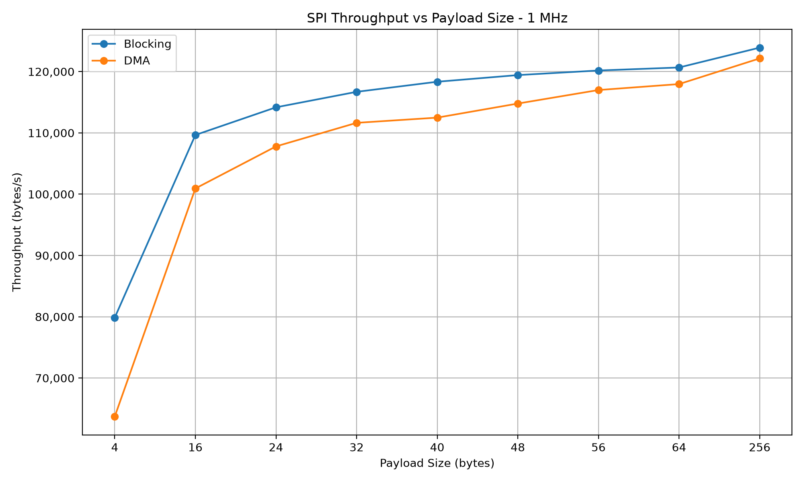
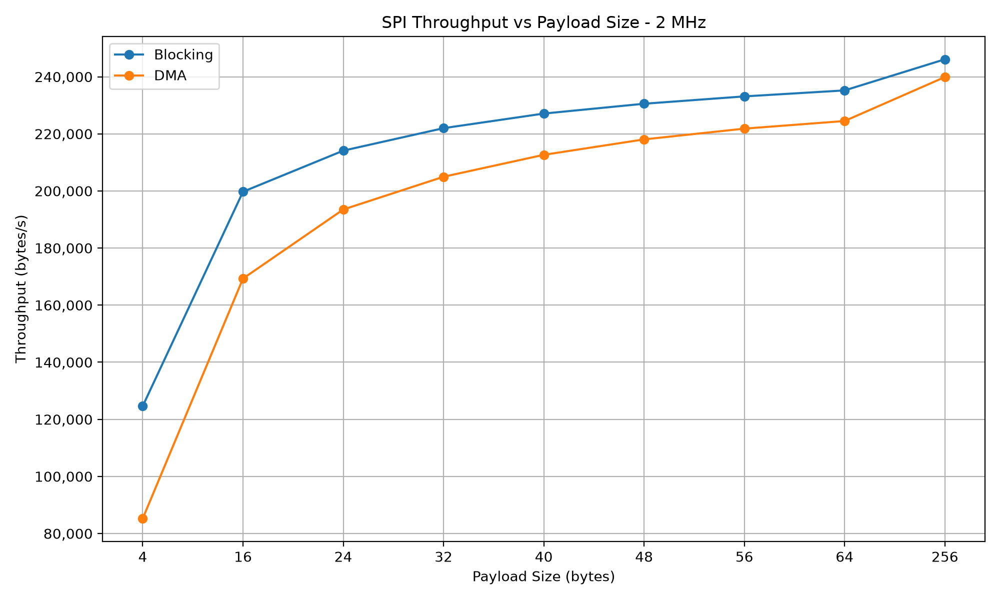
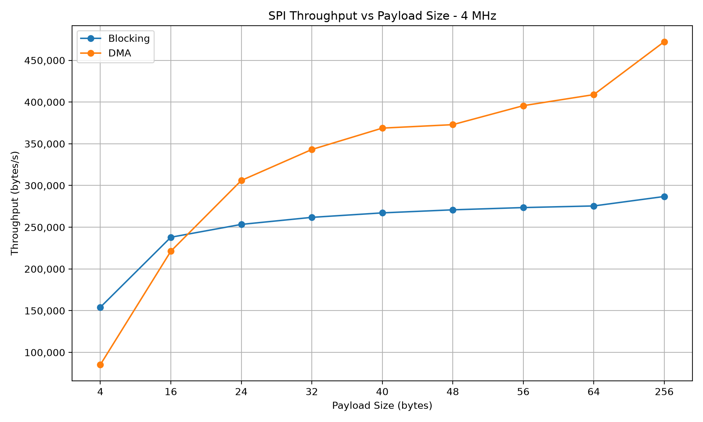
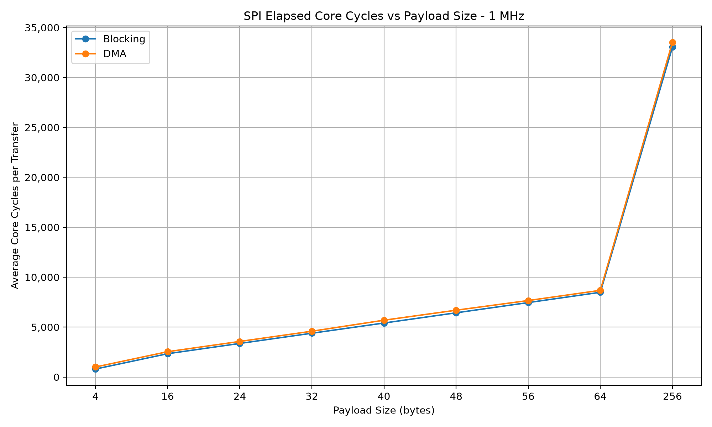
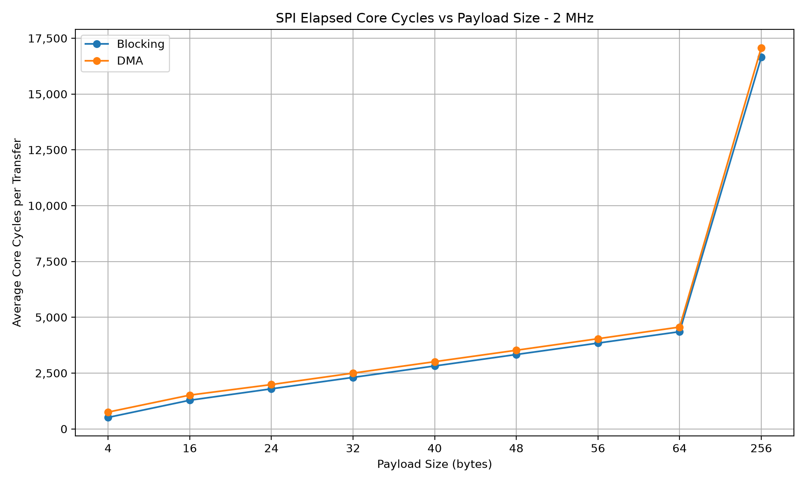
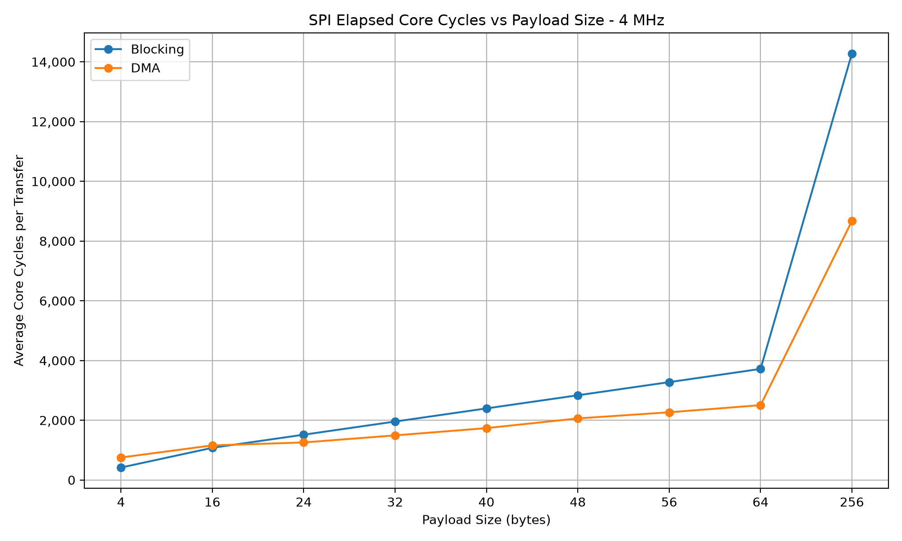
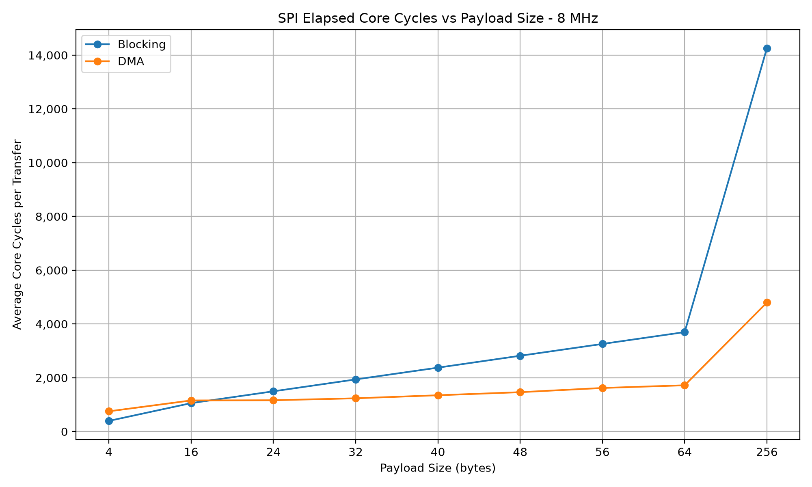

# STM32U585 SPI Performance Benchmark

Embedded Rust benchmarking framework for comparing **blocking SPI and DMA-backed SPI** on the STM32U585.

Built and tested on the **MM6108-EKH05** using **Rust, Embassy, STM32U585, DMA, DWT hardware cycle counting, RTT, and probe-rs**.

The framework measures transfer latency, throughput, timing variation, elapsed
core cycles, task concurrency, SPI clock scaling, and the payload size where
DMA begins to outperform blocking SPI.

---

## Key Results

At **8 MHz SPI with a 256-byte payload**:

| Transfer Method | Throughput | Avg. Elapsed Cycles / Transfer |
|:----------------|-----------:|-------------------------------:|
| Blocking | 287,211 B/s | 14,261 |
| DMA | **853,390 B/s** | **4,800** |

DMA achieved approximately **197% higher throughput** than blocking SPI.

The benchmark also found a blocking-to-DMA crossover between **16 and 24 bytes**
at both **4 MHz and 8 MHz**.


### Main Findings

- Blocking SPI performs better for very small transfers.
- DMA becomes significantly faster as payload size and SPI frequency increase.
- At 1 MHz and 2 MHz, blocking remained faster across the tested payload range.
- At 4 MHz and 8 MHz, DMA overtook blocking between 16 and 24 bytes.
- Blocking throughput began to plateau at higher SPI clock frequencies.
- DMA continued to scale strongly with SPI frequency.
- Embassy tasks continued executing during DMA transfers but not during blocking transfers.
- Cortex-M DWT cycle measurements closely matched expected elapsed core-clock cycles.

---

## Hardware

| Component | Configuration |
|:----------|:--------------|
| Board | MM6108-EKH05 |
| MCU | STM32U585AI |
| Debug Probe | ST-LINK V3 |
| System Clock | 16 MHz HSI |
| SPI Peripheral | SPI1 |
| Maximum Tested SPI Clock | 8 MHz |

### SPI1 Pins

| Signal | Pin |
|:-------|:----|
| SCK | PE13 |
| MISO | PE14 |
| MOSI | PE15 |
| CS | PE12 |

Chip select is controlled in software using PE12.

---

## What the Benchmark Measures

The framework measures:

- transfer latency
- aggregate transfer time
- minimum and maximum transfer time
- throughput
- repeated-transfer performance
- performance across different payload sizes
- performance across different SPI frequencies
- elapsed Cortex-M core cycles
- average elapsed cycles per transfer
- application task concurrency during DMA
- blocking vs DMA performance
- automatic DMA crossover detection

The benchmark currently tests:

```text
SPI clocks:
1 MHz
2 MHz
4 MHz
8 MHz

Payload sizes:
4
16
24
32
40
48
56
64
256 bytes

Iterations per configuration:
100
```

A complete run produces:

```text
4 SPI frequencies
×
9 payload sizes
×
2 transfer methods
=
72 benchmark measurements
```

---

## Performance Results

### Blocking Throughput

| SPI Clock | 4 B | 16 B | 64 B | 256 B |
|----------:|----:|-----:|-----:|------:|
| 1 MHz | 79,856 B/s | 109,656 B/s | 120,670 B/s | 123,909 B/s |
| 2 MHz | 124,649 B/s | 199,750 B/s | 235,216 B/s | 246,118 B/s |
| 4 MHz | 154,083 B/s | 237,706 B/s | 275,482 B/s | 286,828 B/s |
| 8 MHz | 161,420 B/s | 242,314 B/s | 276,912 B/s | 287,211 B/s |

### DMA Throughput

| SPI Clock | 4 B | 16 B | 64 B | 256 B |
|----------:|----:|-----:|-----:|------:|
| 1 MHz | 63,724 B/s | 100,927 B/s | 117,963 B/s | 122,150 B/s |
| 2 MHz | 85,251 B/s | 169,294 B/s | 224,490 B/s | 239,918 B/s |
| 4 MHz | 85,070 B/s | 221,514 B/s | 408,919 B/s | 472,307 B/s |
| 8 MHz | 85,269 B/s | 221,208 B/s | 595,792 B/s | **853,390 B/s** |

### Blocking vs DMA

| SPI Clock | 4 B | 16 B | 64 B | 256 B |
|----------:|:----|:-----|:-----|:------|
| 1 MHz | Blocking +25% | Blocking +8% | Blocking +2% | Blocking +1% |
| 2 MHz | Blocking +46% | Blocking +17% | Blocking +4% | Blocking +2% |
| 4 MHz | Blocking +81% | Blocking +7% | DMA +48% | DMA +64% |
| 8 MHz | Blocking +89% | Blocking +9% | DMA +115% | **DMA +197%** |

These results demonstrate that DMA is not automatically faster than blocking
SPI. Transfer size and bus frequency determine whether the DMA setup and
synchronization overhead is worthwhile.

---

## Throughput Visualization

### 1 MHz



### 2 MHz



### 4 MHz



### 8 MHz


At 4 MHz and 8 MHz, the graphs clearly show the point where DMA begins
outperforming blocking SPI.

---

## DMA Crossover Analysis

Intermediate payload sizes were added specifically to identify the transition
between blocking and DMA performance.

| SPI Clock | Measured Crossover |
|----------:|:-------------------|
| 1 MHz | No crossover detected |
| 2 MHz | No crossover detected |
| 4 MHz | Between 16 and 24 bytes |
| 8 MHz | Between 16 and 24 bytes |

At 8 MHz:

| Payload | Blocking | DMA | Faster |
|--------:|---------:|----:|:-------|
| 16 B | 242,314 B/s | 221,208 B/s | Blocking |
| 24 B | 256,602 B/s | 330,487 B/s | DMA |
| 32 B | 264,397 B/s | 413,597 B/s | DMA |
| 40 B | 269,305 B/s | 474,383 B/s | DMA |
| 48 B | 272,680 B/s | 524,762 B/s | DMA |
| 56 B | 275,143 B/s | 552,649 B/s | DMA |
| 64 B | 276,912 B/s | 595,792 B/s | DMA |

The framework reports an interval rather than an exact byte-level crossover
because only configured payload sizes are measured.

---

## Cortex-M DWT Cycle Measurement

The benchmark uses the Cortex-M **Data Watchpoint and Trace (DWT)** hardware
cycle counter alongside microsecond timing.

For each benchmark it records:

- total elapsed core cycles
- average elapsed core cycles per transfer

### 256-Byte Results

| SPI Clock | Blocking Cycles / Transfer | DMA Cycles / Transfer |
|----------:|---------------------------:|----------------------:|
| 1 MHz | 33,056 | 33,532 |
| 2 MHz | 16,643 | 17,073 |
| 4 MHz | 14,280 | 8,672 |
| 8 MHz | 14,261 | **4,800** |

### Cycle Graphs

#### 1 MHz



#### 2 MHz



#### 4 MHz



#### 8 MHz



At 8 MHz, the 256-byte DMA benchmark transferred 25,600 bytes in approximately:

```text
29,998 us
```

The DWT recorded approximately:

```text
480,019 elapsed core cycles
```

With a 16 MHz system clock:

```text
29,998 us × 16 cycles/us ≈ 479,968 cycles
```

which closely matches the measured DWT value.

### DWT Interpretation

The DWT measurement represents **elapsed processor clock cycles** between the
beginning and end of the benchmark.

For asynchronous DMA transfers, this includes periods where the benchmark task
is suspended while waiting for DMA completion.

Therefore, the value should not be interpreted as CPU utilization or as the
number of CPU instructions executed by the DMA operation.

---

## DMA Concurrency

A background Embassy task increments a counter approximately once per
millisecond while benchmark operations execute.

```rust
#[embassy_executor::task]
async fn cpu_activity_task() {
    loop {
        CPU_ACTIVITY.fetch_add(1, Ordering::Relaxed);
        Timer::after_millis(1).await;
    }
}
```

Measured task progress:

| SPI Clock | Blocking | DMA |
|----------:|---------:|----:|
| 1 MHz | 0 | 854 |
| 2 MHz | 0 | 454 |
| 4 MHz | 0 | 257 |
| 8 MHz | 0 | 178 |

The background task made no progress while blocking transfers were active.

During DMA transfers, the scheduler continued running other application work.

This is evidence of concurrency, not a CPU utilization percentage.

---

## Architecture

The benchmark separates hardware-specific SPI code from benchmark logic using
small transfer interfaces.

```rust
pub trait SpiTransfer {
    fn write(
        &mut self,
        data: &[u8],
    ) -> Result<(), embassy_stm32::spi::Error>;
}

pub trait DmaTransfer {
    async fn write_dma(
        &mut self,
        data: &[u8],
    ) -> Result<(), embassy_stm32::spi::Error>;
}
```

This allows the benchmark engine to operate independently of the underlying SPI
implementation.

### Project Structure

```text
.
├── Cargo.toml
├── build.rs
├── memory.x
├── README.md
│
├── src
│   ├── main.rs
│   ├── benchmark.rs
│   ├── cycle_counter.rs
│   ├── spi.rs
│   ├── timer.rs
│   └── transfer.rs
│
├── tools
│   └── capture_csv.py
│
└── results
    ├── benchmark.csv
    ├── benchmark_table.txt
    └── graphs
        ├── throughput_1mhz.png
        ├── throughput_2mhz.png
        ├── throughput_4mhz.png
        ├── throughput_8mhz.png
        ├── cycles_1mhz.png
        ├── cycles_2mhz.png
        ├── cycles_4mhz.png
        └── cycles_8mhz.png
```

### Main Components

`spi.rs`

- SPI1 configuration
- blocking transfers
- DMA-backed asynchronous transfers
- software chip select
- runtime SPI frequency control

`benchmark.rs`

- repeated benchmark execution
- timing statistics
- throughput calculation
- DWT cycle collection

`cycle_counter.rs`

- Cortex-M DWT initialization
- hardware cycle-counter access

`transfer.rs`

- hardware-independent transfer interfaces

`tools/capture_csv.py`

- launches the benchmark
- captures RTT output
- parses benchmark measurements
- exports CSV
- generates readable tables
- generates benchmark graphs

---

## Benchmark Data

Complete raw measurements are available directly in the repository:

- [Raw CSV](results/benchmark.csv)
- [Formatted Benchmark Table](results/benchmark_table.txt)

The CSV contains:

```text
spi_frequency_hz
method
payload_bytes
iterations
total_bytes
total_elapsed_us
total_elapsed_cycles
average_us
average_cycles
min_us
max_us
throughput_bytes_per_second
```

This makes the measurements usable for additional analysis outside the
firmware.

---

## Generate Results

Install Matplotlib:

```bash
sudo apt install python3-matplotlib
```

Run:

```bash
python3 tools/capture_csv.py
```

The script runs the firmware through `cargo run`, captures RTT output, and
automatically regenerates:

```text
results/benchmark.csv
results/benchmark_table.txt

results/graphs/throughput_1mhz.png
results/graphs/throughput_2mhz.png
results/graphs/throughput_4mhz.png
results/graphs/throughput_8mhz.png

results/graphs/cycles_1mhz.png
results/graphs/cycles_2mhz.png
results/graphs/cycles_4mhz.png
results/graphs/cycles_8mhz.png
```

---

## Build

Install the embedded Rust target:

```bash
rustup target add thumbv8m.main-none-eabihf
```

Build:

```bash
cargo build
```

Build optimized firmware:

```bash
cargo build --release
```

---

## Flash and Run

Connect the MM6108-EKH05 using ST-LINK.

Run:

```bash
cargo run
```

`probe-rs` flashes the STM32U585 and RTT output is displayed using `defmt`.

Example result:

```text
Requested SPI frequency: 8000000 Hz
Actual SPI frequency: 8000000 Hz

Payload size: 256 bytes
Iterations: 100

Blocking throughput: 287211 bytes/s
DMA throughput: 853390 bytes/s

Faster method: DMA
DMA throughput improvement: 197%

DMA crossover detected between 16 and 24 bytes
```

---

## Release Firmware

An optimized firmware image can be created with:

```bash
cargo build --release
```

The ELF executable is generated under:

```text
target/thumbv8m.main-none-eabihf/release/
```

Release artifacts can include:

```text
spi-benchmark.elf
spi-benchmark.bin
spi-benchmark.hex
benchmark.csv
```

The ELF file preserves debugging information, while BIN and HEX files can be
used for direct firmware flashing.

---

## Technologies

- Rust
- Embedded Rust
- Embassy
- STM32U585
- ARM Cortex-M33
- SPI
- DMA
- DWT cycle counter
- asynchronous embedded programming
- probe-rs
- ST-LINK
- defmt / RTT
- Python
- Matplotlib
- Git / GitHub

---

## Development Workflow

The project was developed incrementally using feature branches.

Major completed features include:

```text
benchmark timing
SPI initialization
blocking SPI
transfer abstraction
repeated benchmarking
throughput calculation
multiple payload sizes
transfer statistics
DMA SPI
DMA benchmarking
DMA concurrency testing
automatic blocking/DMA comparison
SPI clock scaling
DMA crossover analysis
DWT core-cycle measurement
CSV export
benchmark visualization
```

Each major feature was built and tested on the STM32U585 before being merged
into `main`.

---

## Why This Project

This project explores an important embedded-systems engineering question:

> When does the additional complexity of DMA actually provide a measurable
> performance advantage over a simple blocking peripheral transfer?

Rather than assuming DMA is always faster, the benchmark measures the trade-off
experimentally across different transfer sizes and SPI frequencies.

The results show that the answer depends strongly on payload size, peripheral
frequency, software overhead, and the ability to overlap communication with
other application work.